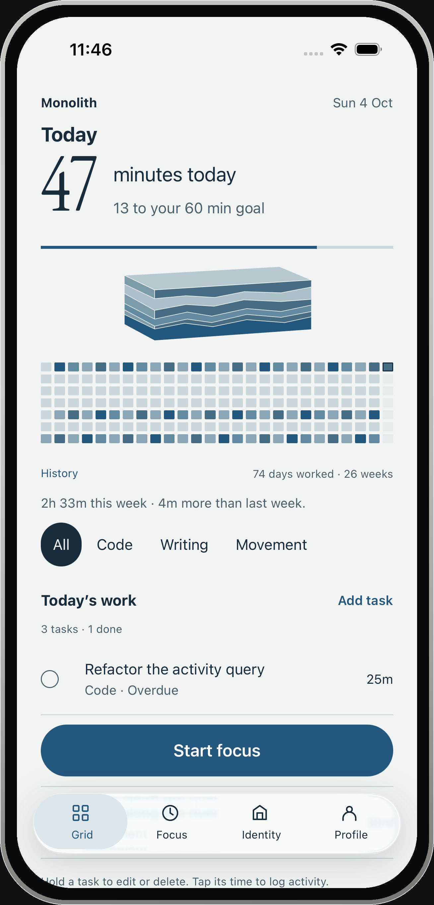
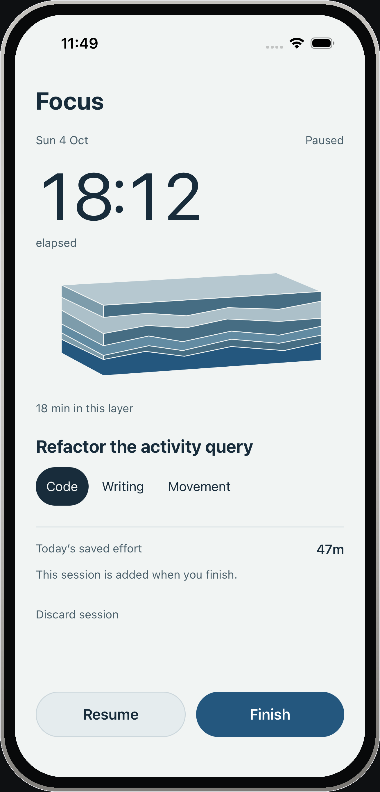
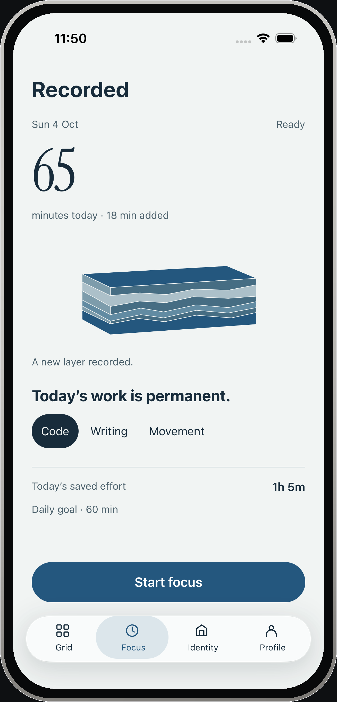
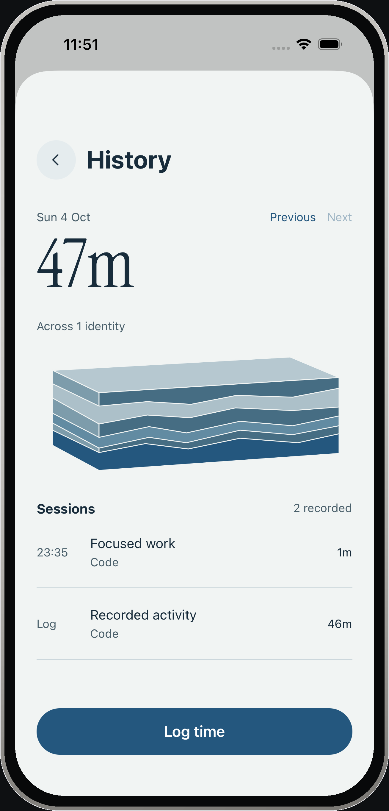
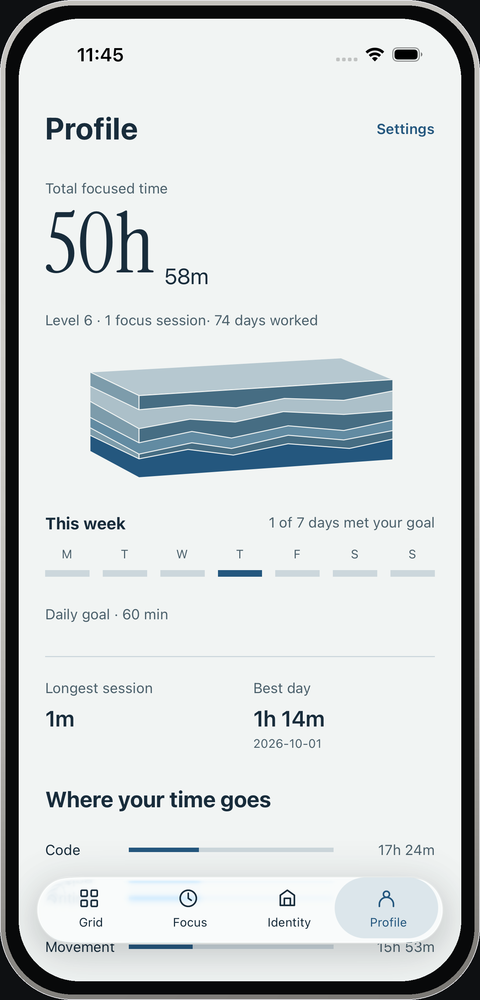
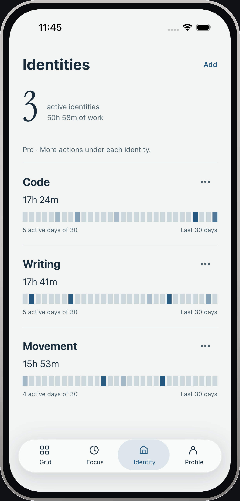
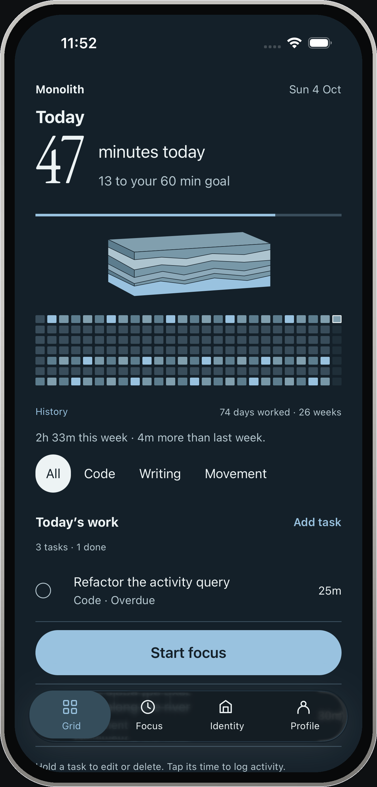

<div align="center">
  

  <h1>Monolith</h1>

  <p><strong>A minimalist, local-first competence tracker.</strong><br />
  Focused work, engraved into a contribution grid — every session deposits a layer of stone.</p>

  <p>
    <a href="#getting-started"></a>
    <a href="#tech-stack"></a>
    <a href="#tech-stack"></a>
    <a href="#whats-built"></a>
    <a href="LICENSE"></a>
  </p>
</div>

> [!IMPORTANT]
> **Monolith is pre-release.** The local-first mobile MVP is built and verified on iOS (Expo Go and a development build), with Android export checks passing. Cloud sync, widgets, notifications, billing, social features, and the desktop app are **not built yet**, and nothing is on the App Store.

## See it in use

<p align="center">
  <a href="redesign/onboarding-core/demo/monolith-hands-on-demo-framed.mp4">
    
  </a>
</p>

<p align="center">
  <a href="redesign/onboarding-core/demo/monolith-hands-on-demo-framed.mp4"><strong>Watch the 34-second demo</strong></a><br />
  <sub>Native iOS · One continuous take · Normal speed · MP4 under 1 MB</sub>
</p>

Inspect a recorded layer, create a task with a time estimate, then start, pause and resume focused work. The blue markers show actual taps and swipes—not a sequence of mockups. Recorded on the iOS Simulator using local demo data.

Every screenshot and frame below is a real iPhone 17 Pro capture from the iOS 26.5 Simulator. The device frame is drawn around the capture; the app pixels inside it are untouched.

[Recording notes and website embed](redesign/onboarding-core/demo/README.md).

## Why Monolith?

Most productivity apps are engagement machines: streaks that shame you, confetti for opening the app, dashboards that measure tapping rather than work. Monolith tracks **competence**, not usage.

- **The grid is the reward.** Focused minutes fill a contribution grid — no badges, no daily-login bonuses, no "Good morning!" popups. The reward is the grid filling up.
- **Strata.** Each identity is a block of stone. Every recorded session or manual log deposits a layer whose thickness reflects real effort — recent work stays distinct while older work compresses into a base that keeps every minute.
- **Local-first.** Everything lives on device (AsyncStorage) and exports as JSON. Supabase accounts and email sign-in are optional; the app works fully offline.
- **Calm motion.** Press springs, a settling tab indicator, and layers that drop into the stone — all reduce-motion and haptics aware.

## Screens

<p align="center">
  
  <br />
  <sub><strong>Grid</strong> — minutes today against your goal, the living strata of recent sessions, 26 weeks of history, identity filters, and today's tasks.</sub>
</p>

<table>
  <tr>
    <td width="50%">
      
      <br /><sub><strong>Focus</strong> — a count-up timer drafts an unsaved layer into the stone; pause, resume, or finish.</sub>
    </td>
    <td width="50%">
      
      <br /><sub><strong>Recorded</strong> — finishing saves exactly once; the new layer settles into the stack.</sub>
    </td>
  </tr>
  <tr>
    <td width="50%">
      
      <br /><sub><strong>History</strong> — any day, its layers and sessions; inspect and correct records with Undo.</sub>
    </td>
    <td width="50%">
      
      <br /><sub><strong>Profile</strong> — totals, level, best day, and where your time goes.</sub>
    </td>
  </tr>
  <tr>
    <td width="50%">
      
      <br /><sub><strong>Identities</strong> — per-identity totals and 30-day activity; Free holds one active identity.</sub>
    </td>
    <td width="50%">
      
      <br /><sub><strong>Dark appearance</strong> — System, Light, and Dark, with the Strata palette adapting.</sub>
    </td>
  </tr>
</table>

## What's built

The full local-first loop is implemented and verified end to end on iOS:

- **Grid** — 26-week contribution grid, identity filters, goal bar, weekly insight, and today's task list
- **Focus** — count-up timer with pause, keep-awake, background recovery, and a live draft layer
- **Strata** — data-driven stone: each session and manual log deposits a sized layer; tap a slice to open the Layer inspector
- **Tasks** — create, edit, complete, delete; estimates, identity, daily/weekly/monthly recurrence, and quick time logging
- **Records** — inspect a layer or day, then edit duration/identity, remove, or undo; edits keep the original task, date, and completion time
- **Identities** — add, edit, archive, restore; Free-tier identity limit enforced during onboarding and later
- **Profile & History** — locally computed totals, level, sessions, days worked, best day, time-share; day detail with previous/next
- **Settings** — appearance, daily goal stepper, local JSON export, confirmed delete-all-local-data
- **Onboarding** — goal, identity seeding, widget step, and a guest path
- **Motion** — press springs, sliding tab indicator, layer drop-in, persisted state hydration; Reduce Motion swaps geometry for fades
- **Backend (optional)** — Supabase schema, RLS, and an auth-profile trigger migration; email sign-up/sign-in UI
- **Quality gates** — TypeScript and ESLint clean; 32 Jest tests across 4 suites; production iOS/Android Hermes and web exports pass

**Not built yet:**

- [ ] Cloud data sync, offline mutation queue, conflict resolution, realtime
- [ ] Home-screen and lock-screen widgets
- [ ] Local notifications and reminders
- [ ] RevenueCat billing and Pro tier gates
- [ ] Crews and the yearly Wrapped report
- [ ] OAuth sign-in (Apple / Google)
- [ ] Desktop app (Tauri)

**Known limits:** verification so far covers the iOS Simulator (Expo Go 57 and a Debug development build), Android builds via production export, and browser QA. Physical-device haptics, Android runtime on a device, VoiceOver, enlarged Dynamic Type, and live widgets are unverified. Supabase is pinned to `~2.105.0` because `2.106.0` leaves an OpenTelemetry dynamic import that Hermes rejects during bytecode generation.

## Tech stack

| Layer | Technology |
|---|---|
| Mobile | Expo SDK 57 · React Native 0.86 · React 19.2 · Expo Router |
| Language | TypeScript 6 (strict) |
| Styling | NativeWind 4 (Tailwind) over the Strata token set |
| State | Zustand, persisted to AsyncStorage; SecureStore for secrets |
| Motion | React Native Reanimated 4 · Worklets · expo-haptics |
| Graphics | react-native-svg — strata, contribution grid, rings |
| Backend | Supabase (Postgres + Auth) — optional; 2 migrations |
| Tests | Jest + jest-expo (32 tests) · ESLint · tsc |
| Monorepo | Turborepo + npm workspaces |

## Project structure

```
monolith/
├── apps/
│   └── mobile/                  # Expo SDK 57 app (iOS 16.4+ · Android · web for QA)
│       └── src/
│           ├── app/             # Screens: (tabs), modals, onboarding
│           ├── components/      # contribution-grid, strata, tasks, focus, insights, ui
│           ├── stores/          # Zustand: app, task, focus, identity, user, log, activityUndo
│           ├── hooks/           # useActivity, useIdentities, useMotion
│           ├── lib/             # strata geometry, activity records, supabase client
│           └── theme/           # Strata tokens, shared with NativeWind
├── packages/
│   └── shared/                  # Date, grid, and XP utilities
├── supabase/migrations/         # Schema, RLS policies, auth profile trigger
├── monolith-design/             # PRD, design system, gamification, business docs
├── redesign/                    # Strata direction, critique, and review evidence
```

## Getting started

**Requirements:** Node 22.13+ (and, for native builds, Xcode with an iOS Simulator or Android Studio). To run on a phone, install Expo Go with SDK 57 support from [expo.dev/go](https://expo.dev/go).

```bash
git clone git@github.com:PratikRai0101/cron.git
cd cron
npm install

cd apps/mobile

# Open in Expo Go (documented QA flow)
npm run go -- --port 8087

# Or build a development client
npm run ios        # Xcode
npm run android    # Android Studio

# Or a quick browser preview
npm run web
```

On an Xcode 27 setup, the CLI may not detect the Simulator through Device Hub; boot the device, then open the app manually:

```bash
xcrun simctl openurl <DEVICE-UDID> exp://127.0.0.1:8087
```

### Optional Supabase

Cloud accounts and auth are optional and off by default:

```bash
cp apps/mobile/.env.example apps/mobile/.env   # set EXPO_PUBLIC_SUPABASE_URL / _ANON_KEY
supabase db push                               # applies supabase/migrations
```

### Quality gates

Run from the repository root:

```bash
npm run type-check
npm run lint
npm test
```

## Documentation

| Document | What it covers |
|---|---|
| [monolith-design/AGENTS.md](monolith-design/AGENTS.md) | Living status doc — what's done, in progress, and next |
| [monolith-design/PRD.md](monolith-design/PRD.md) | Requirements (FR-1…FR-44), screens, data model, edge cases |
| [redesign/fresh/DIRECTION.md](redesign/fresh/DIRECTION.md) | Approved visual system: color, typography, spacing, shape, motion |
| [redesign/onboarding-core/demo/README.md](redesign/onboarding-core/demo/README.md) | Demo videos: the 34-second hands-on cut and the full six-minute walkthrough |
| [monolith-design/GAMIFICATION.md](monolith-design/GAMIFICATION.md) | Progression, momentum, anti-burnout mechanics |
| [monolith-design/SAAS_PLAN.md](monolith-design/SAAS_PLAN.md) | Free/Pro tiers, RevenueCat, unit economics |
| [monolith-design/SOCIAL_FEATURES.md](monolith-design/SOCIAL_FEATURES.md) | Crews, Wrapped, ambient social proof |
| [redesign/fresh/BUILD.md](redesign/fresh/BUILD.md) | Implementation and validation evidence, and limits |
| [redesign/fresh/RUN.md](redesign/fresh/RUN.md) | How to run and verify the Strata build |

## License

[MIT](LICENSE) © Pratik Rai
