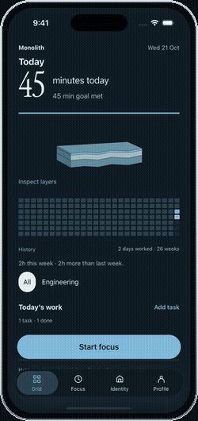

# Monolith demos

[Watch the hands-on demo](monolith-hands-on-demo-framed.mp4) · 34 seconds · 780 × 1626 · 30 fps

[](monolith-hands-on-demo-framed.mp4)

A continuous, normal-speed recording of the native iOS app: inspect a layer, create a task with an estimate, then start, pause and resume task-linked focus. Blue indicators show actual taps and swipes, not mockup transitions.

The recording uses local sample data on the iPhone 17 Pro / iOS 26.5 Simulator. A drawn titanium/black-glass device frame surrounds the capture. The sequence is not cut, stitched or sped up; the GIF is a downsampled preview and the MP4 retains all 1,016 frames at 30 fps.

## Full walkthrough

[Watch the six-minute walkthrough](monolith-full-workflow.mp4): onboarding, task and session flows, history and record editing, identities, profile, settings and dark mode. This is a distinct full-product recording, not a duplicate of the short demo.

## Website embed

Upload the framed MP4 and use:

```html
<video controls muted playsinline preload="metadata"
  aria-label="Monolith hands-on app demo"
  style="display:block;width:100%;max-width:360px;height:auto">
  <source src="monolith-hands-on-demo-framed.mp4" type="video/mp4">
  <a href="monolith-hands-on-demo-framed.mp4">Watch the Monolith demo</a>
</video>
```

Only the published preview and two distinct videos are retained. Frameless duplicates, intermediate captures and one-off recording scripts were removed during repository cleanup; they remain available in Git history.
