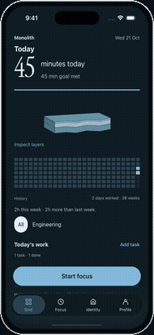

# Monolith — hands-on demo

**[Watch the demo](./monolith-hands-on-demo.mp4)** · 34 seconds · 720 × 1566 · 30 fps · 0.92 MB

A continuous, normal-speed recording of the native iOS app:

1. Inspect a layer and its recorded activity.
2. Scroll to today's work and create a task.
3. Enter a time estimate and save it.
4. Start task-linked focus, then pause and resume.

Blue touch indicators show the actual taps and swipes. The recording uses local sample data on the iOS 26.5 Simulator. It demonstrates the working app, not mockups or a marketing slideshow.

## Preview and sharing

[](./monolith-hands-on-demo.mp4)

Use the MP4 for a portfolio, recruiter email or direct message. The GIF is a smaller-resolution animated preview for GitHub READMEs; click it to open the full-quality video.

For a website, upload the MP4 and use:

```html
<video controls muted playsinline preload="metadata"
  aria-label="Monolith hands-on app demo"
  style="display:block;width:100%;max-width:360px;height:auto">
  <source src="monolith-hands-on-demo.mp4" type="video/mp4">
  <a href="monolith-hands-on-demo.mp4">Watch the Monolith demo</a>
</video>
```

## Capture notes

- Fresh native Release-build capture with `agent-device`, including touch indicators.
- No internal cuts, scene stitching, inserted holds or playback-speed changes.
- Export only resizes and compresses the source. All 1,016 frames remain in their original order and the duration is unchanged.
- Every exported frame was compared with the resized source (minimum SSIM: 0.9957); the complete MP4 also passed a decode check.
- The preview GIF is downsampled for README playback. The MP4 retains the full 30 fps.

This recording replaces the earlier montage-style showcase. The older tracked web recording is retained as historical material, not the recommended demo.
